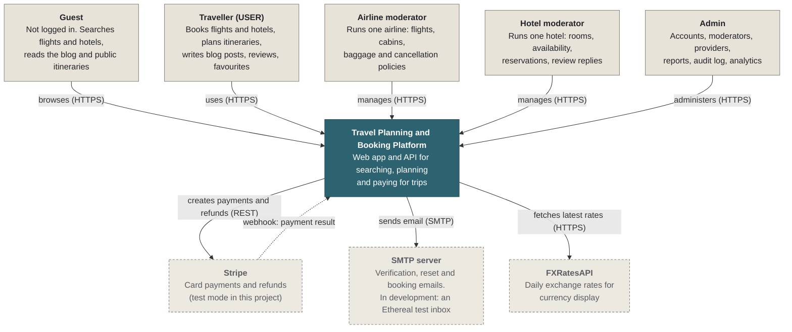

# Level 1: System context

> Verified against `develop` commit `a8e3c80` on 2026-11-27. Legend: [README](README.md#legend).

**Question this answers:** who uses the platform, and which outside systems does it depend on?

## Reading notes

- **Five kinds of visitor.** The backend knows four roles (`USER`, `ADMIN`, `AIRLINE_MODERATOR`, `HOTEL_MODERATOR`, `backend/src/common/enums`). A guest is simply "no role": only routes marked `@Public()` answer.
- **Only the platform talks to Stripe with secrets.** The browser is meant to send card details to Stripe directly (Stripe.js), so card data never reaches our API. The checkout page that does this is planned (ticket M2-51), not built yet.
- **A booking is confirmed only by Stripe's webhook**, never by the browser telling us the payment worked. See [flow c](05-dynamic-flows.md#c-flight-booking-payment-and-confirmation).
- **Reference data** (airports, cities, countries, attractions) is loaded into MongoDB once by `npm run seed` from CSV files in `backend/data/`. It is not a live external system.
- **Currency:** prices and payments use one platform currency (`PLATFORM_CURRENCY`, default USD); FXRatesAPI rates are only for showing converted amounts.
