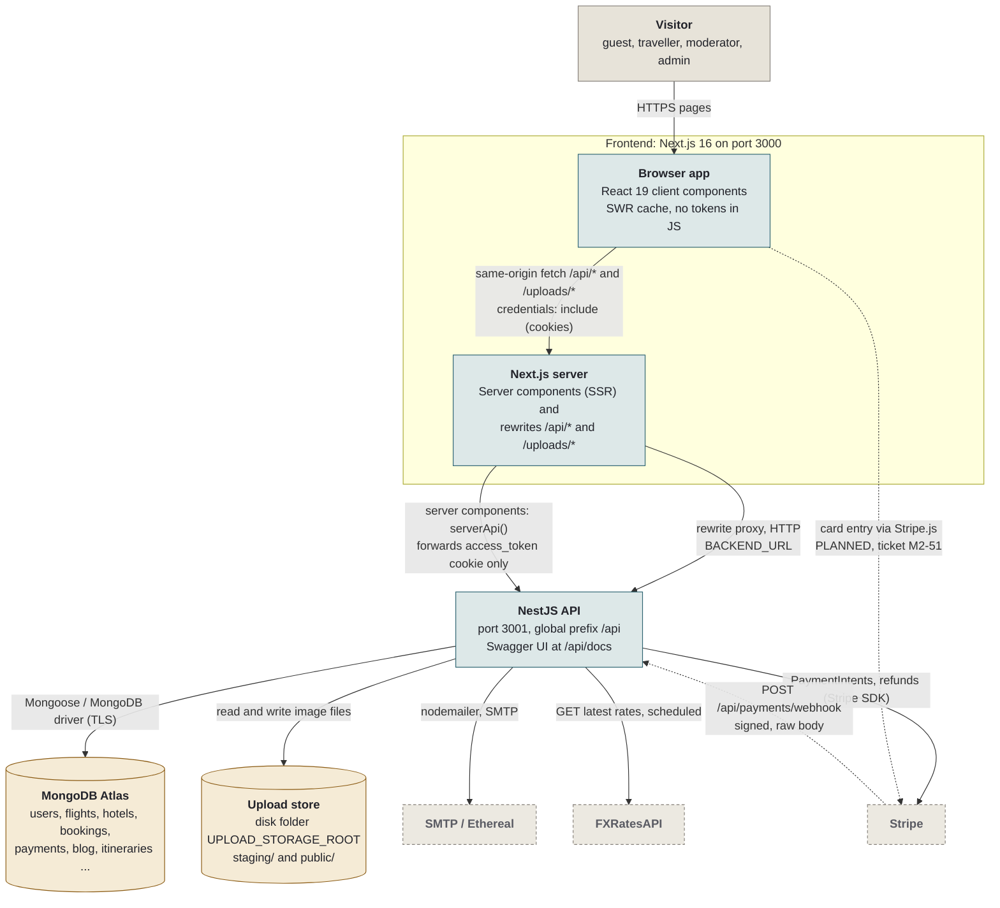

# Level 2: Containers

> Verified against `develop` commit `a8e3c80` on 2026-11-27. Legend: [README](README.md#legend).

**Question this answers:** which deployable pieces make up the platform, and how do they talk to each other?

## Key mechanisms

| Mechanism | How it works | Where |
|---|---|---|
| **Same-origin proxy** | The browser only ever talks to port 3000. Next.js rewrites `/api/*` and `/uploads/*` to the backend, so cookies are same-origin: no CORS and no cross-site cookie settings. | `frontend/next.config.ts` |
| **Cookie auth** | Login sets two httpOnly cookies. `access_token` lives 15 minutes (path `/`). `refresh_token` lives 30 minutes sliding and is sent only to `/api/auth/*`. Both are `sameSite: lax`; `secure` follows `COOKIE_SECURE` or `NODE_ENV=production`. JavaScript never sees a token; the user object comes from `GET /api/auth/me`. | `backend/src/auth/auth-cookies.ts` |
| **Silent refresh** | On a 401, `api()` calls `POST /api/auth/refresh` once (shared by parallel requests, because refresh tokens rotate and are single use), retries once, otherwise redirects to `/login?returnTo=`. | `frontend/src/lib/api.ts`. See [flow a](05-dynamic-flows.md#a-login-cookies-silent-refresh-and-redirect) |
| **Server rendering with cookies** | A server component calls the backend directly with `BACKEND_URL` and forwards only `access_token`. It never refreshes (it cannot set cookies while rendering); on 401 it renders a client component that refreshes in the browser. | `frontend/src/lib/serverApi.ts`. See [flow e](05-dynamic-flows.md#e-server-component-fetch-with-browser-fallback-on-401) |
| **Typed API** | Swagger JSON from the API is saved as `frontend/openapi/openapi.json` and turned into `frontend/src/api/schema.d.ts` by `openapi-typescript`. Helpers `ResponseOf`, `QueryOf`, `BodyOf`, `Schema` read it. A backend change then shows up as a TypeScript error. This is a manual step (`npm run gen:api`), so the snapshot can go stale: see [FINDINGS](FINDINGS.md). | `frontend/src/api/` |
| **Uploads** | A multipart `POST` with a field named `image` (for example `/api/posts/:id/images`, max 5 MB, JPG or PNG) is validated, tracked by an `UploadedFile` record (`pending`, then `ready`) and written to the upload store. The API returns `{ id, url }` with URLs like `/uploads/<id>.png`, which are outside `/api`, hence the second rewrite. Files are served from the store's `public/` folder by ServeStatic, behind a visibility middleware (images of a draft post are only readable by their owner). | `backend/src/uploads/`. See [flow d](05-dynamic-flows.md#d-image-upload-and-display) |
| **Payments** | The API creates a Stripe PaymentIntent and returns its `clientSecret`. Only the signed webhook `payment_intent.succeeded` confirms a booking. | `backend/src/payments/`. See [flow c](05-dynamic-flows.md#c-flight-booking-payment-and-confirmation) |
| **Background jobs** | `@nestjs/schedule` crons inside the API: expire overdue holds every minute, flight status every minute, daily maintenance, FX refresh. No separate worker container. | `payments/booking-lifecycle.service.ts`, `flights/flight-status.job.ts`, `fx/fx-rate-refresh.job.ts` |

## What is not here

- No separate database for sessions: access tokens are stateless; refresh and revoked tokens are documents in MongoDB.
- No CDN, queue, cache server or search engine. Search is MongoDB queries.
- Card details never reach the API (by design).
