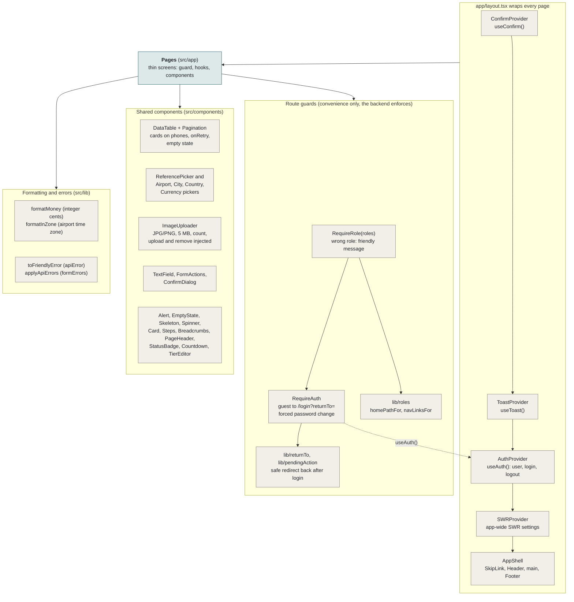
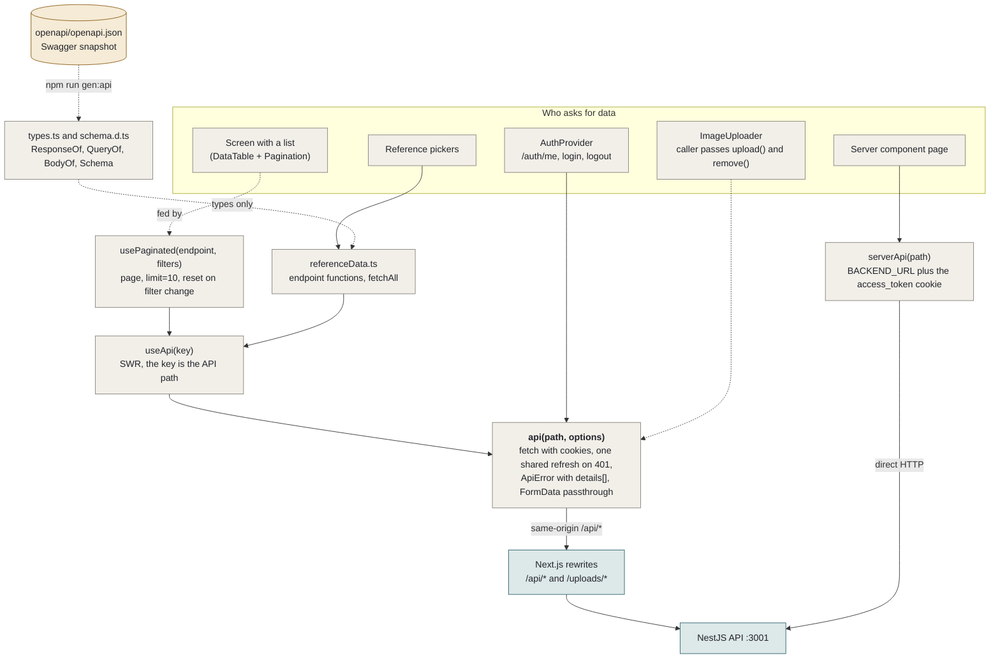
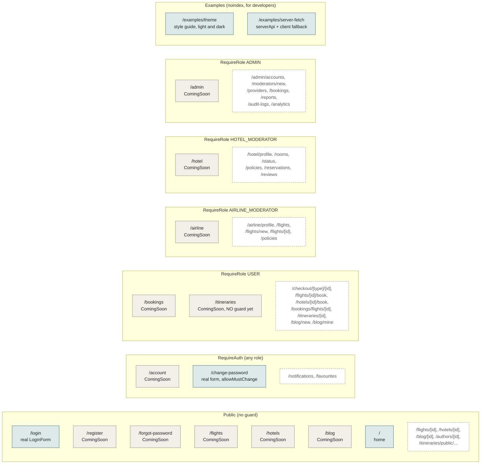
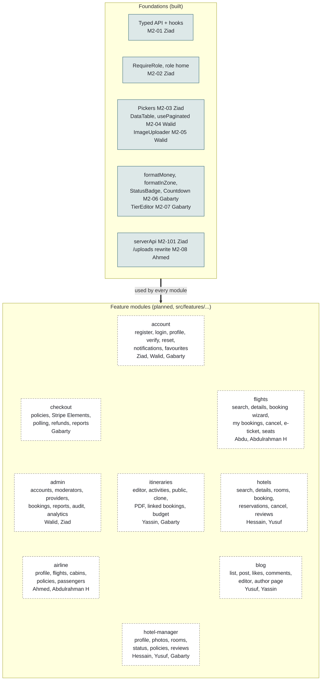

# Level 3: Frontend components

> Verified against `develop` commit `a8e3c80` on 2026-11-27. Legend: [README](README.md#legend).

**Question this answers:** what is inside the Next.js frontend, and how do its parts depend on each other?

The frontend today is a **solid foundation with almost no screens yet**: the shared building blocks, the typed API layer and the route guards exist and are tested; most pages are `ComingSoon` placeholders waiting for the feature tickets. Solid boxes below exist in the code; **dashed boxes are planned** (tickets in [section C](#c-feature-modules-and-owners)).

## A. Layers and dependencies

Read it top to bottom. Diagram A1 shows what wraps and protects a page; diagram A2 shows how any screen reaches the backend through one path that ends in `api()`.

### A1. Providers, guards and shared components

### A2. The typed API layer: how a screen reaches the backend

### What each part is for

| Part | Why it exists | File |
|---|---|---|
| `api()` | The only way the browser calls the backend. Cookies, one shared refresh on 401 (tokens rotate, so parallel failures must share one refresh), redirect to login, backend error shape `{ statusCode, message, details[] }` as `ApiError`. | `src/lib/api.ts` |
| `useApi` | SWR wrapper. The key is the API path, so every component sharing it shares the cache and `mutate(key)` refreshes all. 4xx answers are not retried. | `src/api/useApi.ts` |
| `usePaginated` | Standard list hook (`?page=&limit=10`), resets to page 1 on new filters, steps back if the last page empties. Returns `items`, `data`, `isLoading`, `error`, `revalidate`. | `src/api/usePaginated.ts` |
| `serverApi` | Server-component fetch with the visitor's `access_token` only; returns `{ ok: false, reason: 'unauthorized' }` on 401 so the page can fall back to a client component. | `src/lib/serverApi.ts` |
| `RequireAuth` / `RequireRole` | Hide a page from guests / the wrong role, and send people with a temporary password to `/change-password`. Nothing protected renders until the check passes. | `src/components/` |
| Types | Generated from the backend's Swagger snapshot, never hand-written. | `src/api/types.ts`, `schema.d.ts` |

### The standard recipe for a list screen

`Skeleton` while loading, then `Alert` with Retry on error, then `EmptyState` when empty, then content. `DataTable` has all four built in. See [flow b](05-dynamic-flows.md#b-a-paginated-list-screen).

## B. Routes by area (built and planned)

Route guards and what each page contains **today**. Solid = exists in `src/app`; dashed = planned in the route map of the frontend plan but no file yet.

Legend for this diagram: teal = working screen, grey = placeholder (`ComingSoon`), dashed = planned.

**Role landing page after login:** USER to `/` (or `returnTo`), AIRLINE_MODERATOR to `/airline`, HOTEL_MODERATOR to `/hotel`, ADMIN to `/admin`, any user with a temporary password to `/change-password` (`src/lib/roles.ts`, `LoginForm.tsx`). The header shows role-specific links (`navLinksFor`); it links only to routes that exist today.

## C. Feature modules and owners

The plan puts each feature in `src/features/<module>/` (own `api.ts`, `hooks.ts`, `schemas.ts`, `components/`) with one owner, so pull requests rarely collide. **No `src/features/` folder exists yet**: every module below is planned. Owners and tickets come from `travel-m2-plan/tickets.csv`.

Ticket ranges per module: account M2-11..19, admin M2-21..28, flights M2-31..38 and M2-85/86, hotels M2-41..49, checkout/shared M2-51..54, itineraries M2-55/56 and M2-61..68, blog M2-71..79, airline M2-81..84, hotel policies M2-87. Cross-cutting: walkthrough M2-91, SEO and accessibility pass M2-98, deployment M2-102..104.
