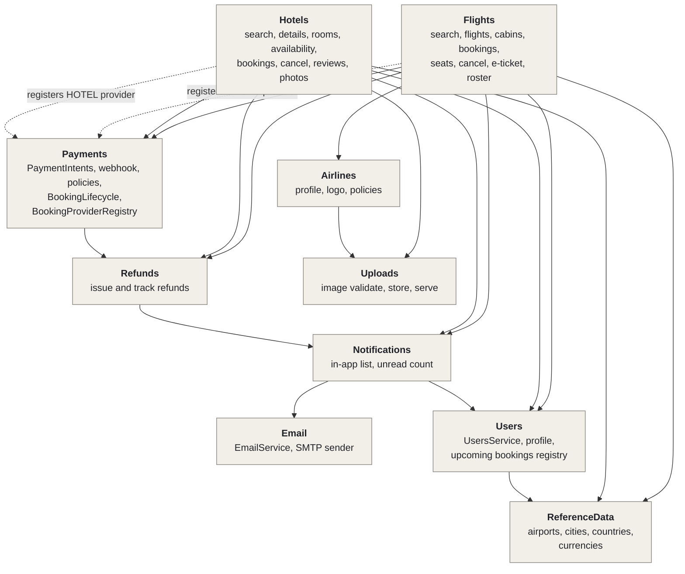
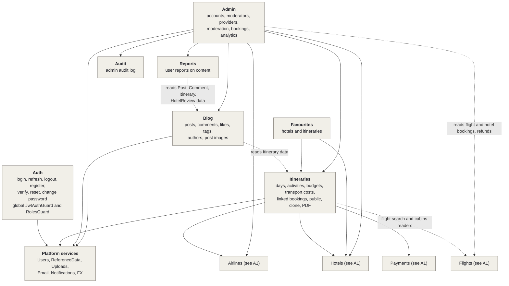
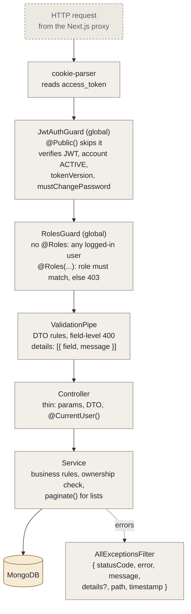

# Level 3: Backend components

> Verified against `develop` commit `a8e3c80` on 2026-11-27. Legend: [README](README.md#legend).

**Question this answers:** what modules make up the NestJS API, which ones depend on which, and how is access controlled?

The API is a NestJS modular monolith (`backend/src`): 18 feature modules (17 registered in `app.module.ts`, plus Users via Auth), plus shared code in `common/` and `config/`. It exposes 144 routes across 60 controller classes. Each module has an owner; the working rule is "never edit another person's module", so cross-module calls go through exported services or the registry below.

## A. Module dependencies

An arrow `A --> B` means module A imports module B (`imports: [...]` in the Nest module). Dotted arrows are looser couplings that are not a module import. To stay readable the picture is split in two: booking and money first, then content and back office.

### A1. Booking and money

- **Payments does not import Flights or Hotels.** They register themselves in `BookingProviderRegistry` (`onModuleInit`), so there are no circular module imports and a new bookable thing needs no change in Payments. A booking type with no provider answers a clean 4xx.
- `PaymentsModule` imports `RefundsModule`; `RefundsModule` reuses the Stripe gateway class from the payments folder without importing the module.

### A2. Content, auth and back office

The box "Platform services" stands for the shared modules **Users, ReferenceData, Uploads, Email, Notifications and FX**; most modules import two or three of them (the exact imports are in each module's `imports` array).

- **Admin is the widest module**: it touches eight others, mostly read-only, and writes an audit record for each privileged action through `AuditService`.
- **Cross-module data reads** (dotted arrows) go through `MongooseModule.forFeature` of the other module's schema, not through its service. They do not show up as module imports, so they are the first thing to check when a schema changes.

## B. How a request is processed

Every route goes through the same pipeline, set up in `setup-app.ts` and the global guards in `AuthModule`.

- **Ownership is checked in the service, not the controller.** Users only reach their own bookings, itineraries, posts and reviews (404 for someone else's private resource); a moderator editing a different airline or hotel gets 403.
- **`@AllowWhenMustChange()`** lets only `me`, `change-password` and `logout` through for an account with a temporary password.
- **Uploads bypass the guards** (they are served by a raw middleware mounted at `/uploads`) and run their own visibility check that reuses `JwtAuthGuard`.

## C. Modules, main parts and who may call them

Roles in the last column are the `@Roles(...)` found on the controllers. "any login" means the route has no `@Roles`, so every logged-in role passes. "public" means `@Public()`.

| Module | Main controllers (route prefix) | Main services and parts | Access |
|---|---|---|---|
| Auth | `auth` | `AuthService`, `EmailVerificationService`, `PasswordResetService`, `TokenRevocationService`, cookie helpers, login lockout (5 tries, 15 min) | mostly public (register, login, refresh, logout, forgot/reset, verify); `me`, `change-password`, `resend-verification` any login |
| Users | `users` | `UsersService`, `ProfileService`, `AccountDeactivationService` | `me` GET/PATCH any login; `DELETE me` USER |
| Admin | `admin/accounts`, `admin/moderators`, `admin/providers`, `admin/users`, `admin/content`, `admin/reports`, `admin/bookings`, `admin/analytics` | `AdminService`, `ModeratorAccountsService`, `ProviderStatusService`, `AccountStatusService`, `AdminContentService`, `ReportsAdminService`, `AdminPasswordResetService` | ADMIN (class-level) |
| Audit | `admin/audit-logs` | `AuditService` | ADMIN |
| Airlines | `airlines`, `airlines/:id/logo` | `AirlinesService`, `AirlineLogoService` | `GET :id` public; create ADMIN; edit, policies, logo AIRLINE_MODERATOR |
| Flights | `flights`, `flights/:id/cabins`, `flights/mine`, `flight-bookings` | `FlightsService`, `FlightSearchService`, `FlightBookingsService`, `FlightCabinsService`, `FlightSeatSelectionService`, `FlightCancellationService`, `FlightETicketService`, `FlightBookingProvider`, `FlightStatusJob` | search and `GET :id` public; flight and cabin writes AIRLINE_MODERATOR; all `flight-bookings` USER |
| Hotels | `hotels` (search, details, rooms, availability, reservations, photos, policies), `hotel-bookings`, `reviews` | `HotelsService`, `RoomsService`, `HotelSearchService`, `HotelAvailabilityService`, `HotelBookingsService`, `HotelBookingCancellationService`, `HotelReviewsService`, `HotelPhotosService` | search, details, free rooms, reviews list public; create hotel ADMIN; hotel writes, rooms, photos, reservations, review reply HOTEL_MODERATOR; bookings and own reviews USER |
| Payments | `payments`, `bookings/:type/:id/policies` | `PaymentsService`, `PolicyAcceptanceService`, `BookingLifecycle`, `BookingProviderRegistry`, `StripePaymentGateway`, `RefundCalculator` | USER; `POST payments/webhook` public but signature-verified |
| Refunds | `refunds` | `RefundsService` | USER |
| Itineraries | `itineraries`, `itineraries/public`, `activities`, `budgets`, `transport-costs` | `ItinerariesService`, `ItinerariesPublicService`, `ActivitiesService`, `BudgetsService`, `TransportCostsService`, `ItineraryBookingsService`, `ItineraryPdfService` | public search, detail and PDF for public itineraries; everything else any login (ownership in service) |
| Blog | `posts`, `posts/:id/comments`, `posts/:id/images`, `posts/:id/itinerary`, `comments`, `tags`, `authors` | `BlogService`, `CommentsService`, `PostImagesService`, `AuthorsService`, `PostItineraryService` | list, detail, tags, authors public; rest any login (ownership in service) |
| Favourites | `favourites` | `FavouritesService` | any login |
| Reports | `reports` | `ReportsService`, `ContentLookupService` | any login |
| Notifications | `notifications` | `NotificationsService` | any login |
| ReferenceData | `airports`, `countries`, `cities`, `currencies` | `ReferenceDataService` | public |
| FX | none | `FxService`, `FxRateRefreshJob` | internal |
| Email | none | `EmailService`, `SmtpEmailSender` (real SMTP or an Ethereal test inbox) | internal |
| Uploads | `/uploads/*` (static) | `UploadService`, `UploadStorage`, `UploadRecoveryService`, `UploadVisibilityMiddleware` | public files; draft-post images owner only |

### Shared code (`common/`, `config/`)

`common` holds the global guards (`JwtAuthGuard`, `RolesGuard`), decorators (`@Public`, `@Roles`, `@CurrentUser`, `@AllowWhenMustChange`), enums (`Role`, `BookingStatus`, `PaymentStatus`, ...), `paginate()` with the `{ items, page, limit, total, totalPages }` envelope (page size max 50), the validation pipe, the exception filter, money and local-time helpers, and Swagger helpers (`addValidationErrorResponses`). `config` validates the environment at start-up (`env.validation.ts`). The contract every module follows is in `docs/contracts.md`.
