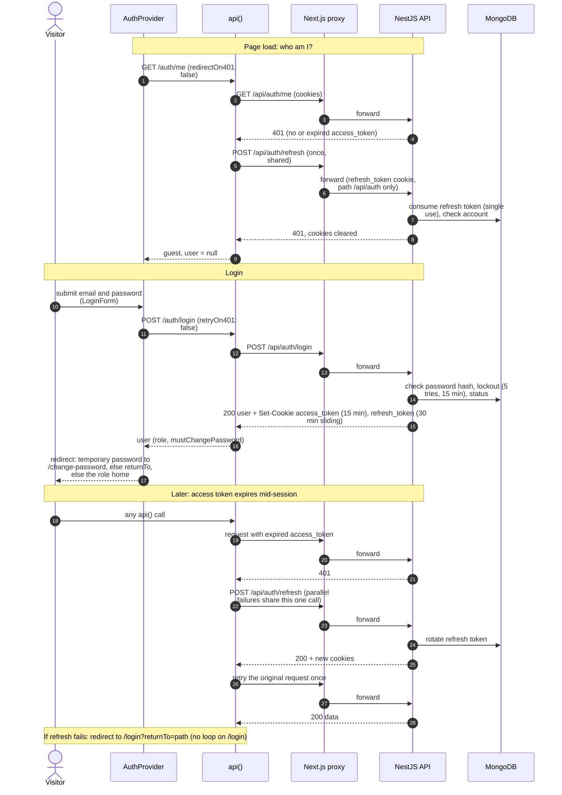
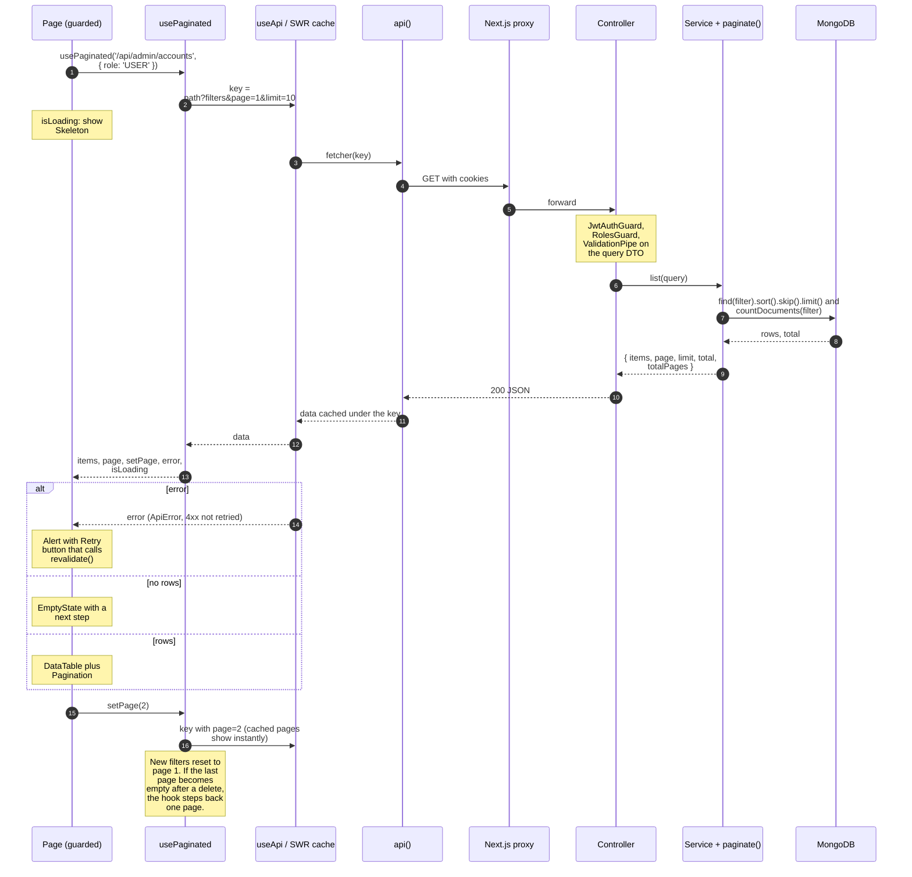
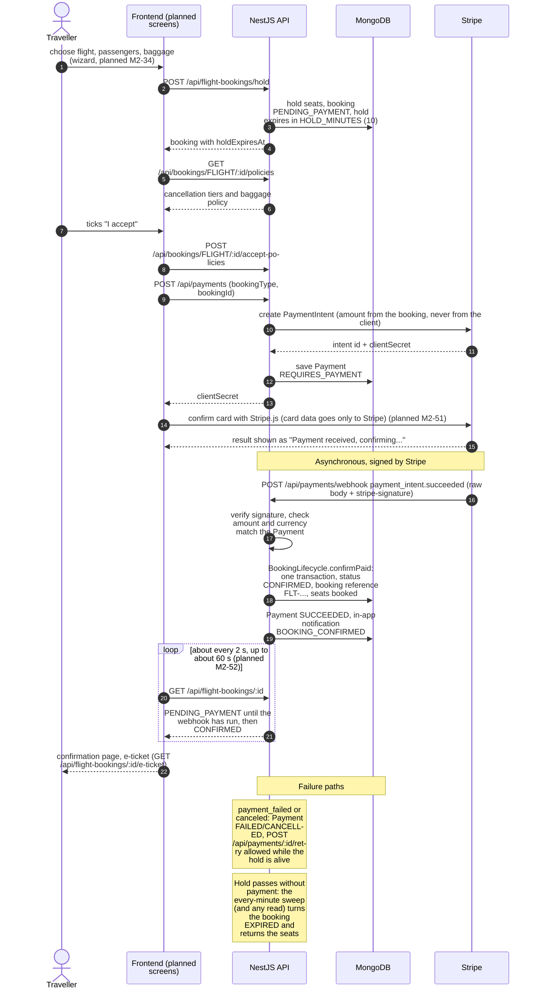
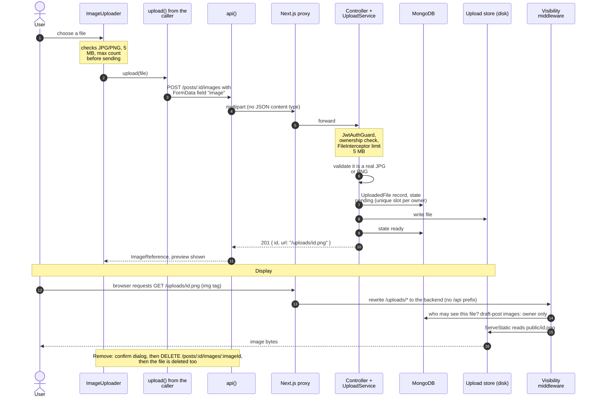
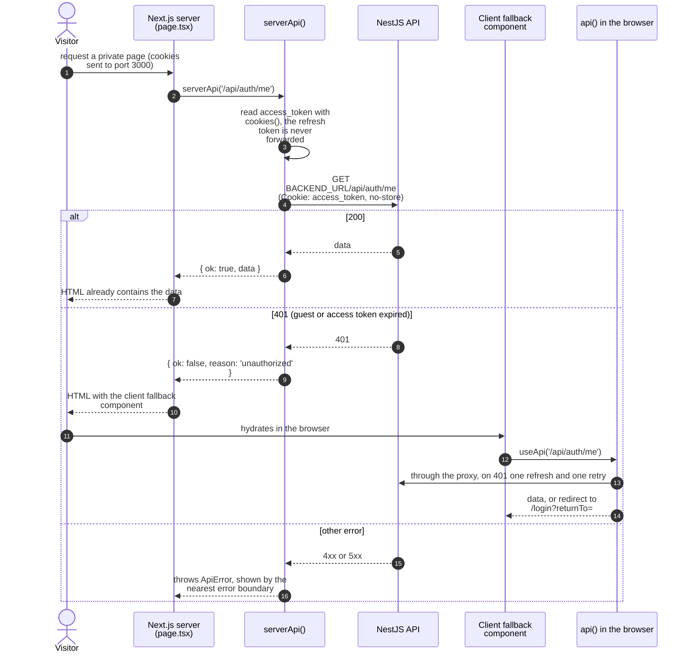

# Dynamic diagrams: how the parts interact

> Verified against `develop` commit `a8e3c80` on 2026-11-27. Legend: [README](README.md#legend).

These are C4 "dynamic" diagrams: numbered interactions between the containers and components of levels 2 and 3, for the five flows that explain most of the system. Steps marked **(planned)** describe a screen that is not built yet; the backend half of those flows is real.

1. [Login, cookies, silent refresh and redirect](#a-login-cookies-silent-refresh-and-redirect)
2. [A paginated list screen](#b-a-paginated-list-screen)
3. [Flight booking, payment and confirmation](#c-flight-booking-payment-and-confirmation)
4. [Image upload and display](#d-image-upload-and-display)
5. [Server component fetch with browser fallback on 401](#e-server-component-fetch-with-browser-fallback-on-401)

## a. Login, cookies, silent refresh and redirect

**Why it matters:** this is the one mechanism every private screen relies on. Tokens exist only in httpOnly cookies; the page knows who you are only through `GET /api/auth/me`.

Role home after login: USER `/`, AIRLINE_MODERATOR `/airline`, HOTEL_MODERATOR `/hotel`, ADMIN `/admin` (`src/lib/roles.ts`).

## b. A paginated list screen

**Why it matters:** every list in the app (bookings, accounts, flights, reports) is meant to follow this exact path, so the same four states appear everywhere. Today only the example screen and the tests use it.

## c. Flight booking, payment and confirmation

**Why it matters:** the riskiest flow. Money is involved, and the booking must never be confirmed by anything except Stripe's signed webhook.

Hotel bookings follow the same payment path through `POST /api/hotel-bookings` and `bookings/HOTEL/...`; both register as providers in `BookingProviderRegistry`. For local demos the webhook only arrives if `stripe listen --forward-to localhost:3001/api/payments/webhook` is running ([dev-setup](../dev-setup.md)).

## d. Image upload and display

**Why it matters:** images are the one place the browser sends multipart data, and the returned URLs live outside `/api`.

The uploader itself never calls the API: each screen passes `upload()` and `remove()` that call the right endpoint (blog post images, hotel photos, airline logo, activity images). A wrapper for those endpoints does not exist yet; see [FINDINGS](FINDINGS.md).

## e. Server component fetch with browser fallback on 401

**Why it matters:** six private pages are planned to render on the server (booking details, itinerary detail, role dashboards). Refresh tokens rotate, and a server component cannot set cookies while rendering, so it must never refresh by itself.

The working example is `src/app/examples/server-fetch/`. Copy its shape for real pages.
