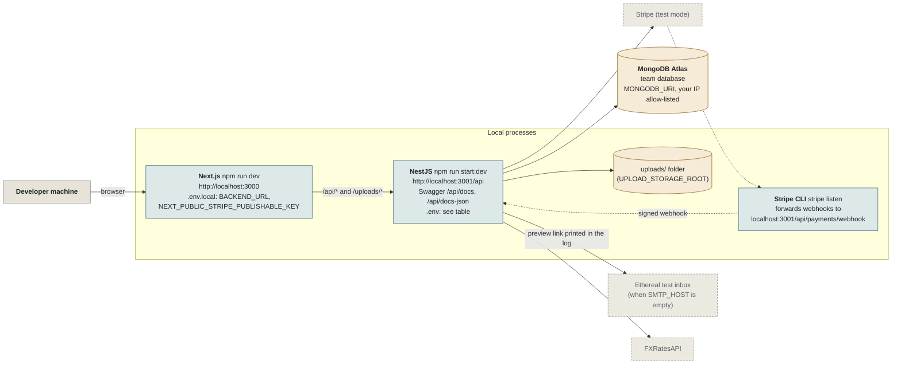

# Optional: development environment

> Verified against `develop` commit `a8e3c80` on 2026-11-27. Legend: [README](README.md#legend). Setup steps themselves are in [docs/dev-setup.md](../dev-setup.md); this page only shows how the pieces connect.

## Environment variables that change behaviour

| Variable | Where | Effect |
|---|---|---|
| `BACKEND_URL` | frontend | Where Next.js proxies `/api/*` and `/uploads/*` and where server components call. Default `http://localhost:3001`. |
| `NEXT_PUBLIC_STRIPE_PUBLISHABLE_KEY` | frontend | Public test key for Stripe.js (checkout, planned). Never a secret key: `NEXT_PUBLIC_*` goes to every browser. |
| `PORT`, `FRONTEND_URL` | backend | API port (3001) and the one allowed CORS origin (3000). |
| `MONGODB_URI`, `JWT_ACCESS_SECRET`, `JWT_REFRESH_SECRET` | backend | Required; validated at start-up. |
| `COOKIE_SECURE` | backend | `false` for local http; defaults to true when `NODE_ENV=production`. Wrong value means login cookies are not stored. |
| `STRIPE_SECRET_KEY`, `STRIPE_WEBHOOK_SECRET` | backend | Payments. The webhook secret is the `whsec_...` that `stripe listen` prints. |
| `HOLD_MINUTES`, `PLATFORM_CURRENCY` | backend | Booking hold length (default 10) and the single platform currency (default USD). |
| `SMTP_*` | backend | Empty means an Ethereal test inbox; the preview URL of each email is logged. |
| `AUTO_VERIFY_EMAIL` | backend | Dev/demo only. Exactly `true` verifies new accounts without an email. |
| `UPLOAD_STORAGE_ROOT` | backend | Folder for uploaded images (default `./uploads`). A temporary disk on a host loses images on restart. |
| `FX_API_KEY` | backend | Optional key for FXRatesAPI. |
| `ADMIN_SEED_*` | backend | Used only by `npm run seed:admin`. |

## Automation around the code

- **Pre-push hook** (`.githooks/pre-push`): builds and lints the backend before a push.
- **CI** (`.github/workflows/ci.yml`): on every pull request into `develop` and every push to `develop`: backend build, lint, unit and e2e tests (in-memory MongoDB, no secrets) and the frontend lint, typecheck, test, build. A pull request that only touches `frontend/`, `docs/`, Markdown or `AI_PROMPTS.txt` skips the long backend run.
- **PR checklist** (`.github/workflows/pr-checklist.yml`): fails while any `- [ ]` box in the pull request description is unticked.
